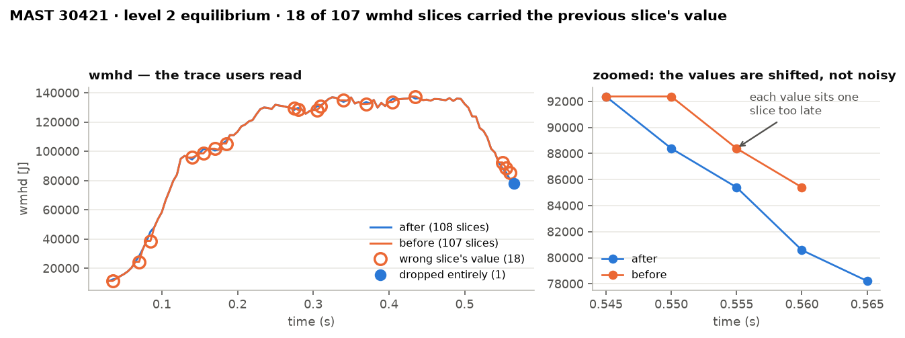
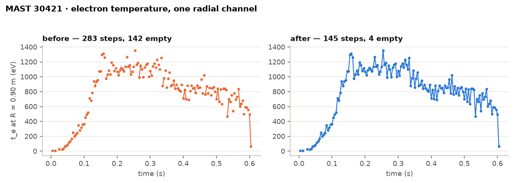

# Release History

Level 2 is regenerated from the MAST archive when we correct a problem, and the
new files replace the old ones at the same paths. The same shot downloaded at
different times can therefore differ in its values or its shape. This page lists
every change that affects level 2 data, newest first, and what you will see in
files produced before it.

For what each correction is and why we made it, see [Corrections](corrections.md).

## Which version do you have?

Every level 2 group records when it was produced, and which version of the
[ingestion code](https://github.com/ukaea/fair-mast-ingestion) produced it:

```python
import xarray as xr

ds = xr.open_zarr("https://s3.echo.stfc.ac.uk/mast/level2/shots/30421.zarr", group="summary")
print(ds.attrs["ingested_at"], ds.attrs["commit_url"])
```

| Release | Ingested | Includes |
| --- | --- | --- |
| **Corrections release** | TBC | Every change on this page |
| **September 2026** | 23–29 September 2026, from ingestion commit `ed6ea4e` | Changes up to 24 August 2026 |

## Corrections release

% TODO: add the release date once the re-ingest is published.

If you downloaded data before this release, it differs as described below.

### Problems in the archive, now corrected

- **Flux loop CC04 is withheld from shot 25366.** Earlier files carry its reversed
  values (shots 25470–25793) and dead values (from 25794).
  See [AMB: flux loops](corrections.md#amb-flux-loops).
- **Saddle coils M02, M08 and M012 are sign-corrected.** Earlier files carry them
  reversed: in `b_field_tor_probe_saddle_field` from shot 24782, and in
  `b_field_tor_probe_saddle_voltage` up to shot 24781.
  See [ASM](corrections.md#asm-saddle-coil-field) and
  [XMB](corrections.md#xmb-saddle-coil-voltage).
- **PF coil current scaling is complete.** The solenoid (`SOL`) is halved again,
  and `P6L`/`P6U` are multiplied by 4. In the September 2026 files the solenoid
  current is twice the true value and the P6 currents are a quarter of it.
  See [AMC: PF coil currents](corrections.md#amc-pf-coil-currents).

### Fixes to our own processing

These were bugs in how level 2 was produced, not problems in the archive.

#### Samples dropped or misplaced on the time grid

**Affected:** level 2 datasets resampled onto a uniform time grid, most visibly
`equilibrium`, `magnetics`, `summary`, `bolometer`, and the 50 µs datasets
(`pf_active`, `pulse_schedule`, `controllers`, `gas_injection`).

Level 2 decided whether a sample belonged to a grid point by testing whether
their times matched to within floating-point precision. That test is far too
strict for the archive's time axes, which are only approximate (see
[Time Bases](time-bases.md)), and it was strictest of all close to *t* = 0. As a
result:

- **EFIT time slices carried the previous slice's values.** On shot 30421, 18 of
  the 107 `wmhd` slices each sat one slice too late. A shifted value is worse than
  a gap, because it is not visible.
- **Whole EFIT solutions were dropped.** On shot 30421, two solutions were lost:
  129 of the 141 were present before the fix and 131 after.
- **Fine-step samples landed on the wrong grid point.** On shot 26399, only 2,293
  of 4,200 `pf_active` grid points carried their own sample before the fix; all
  4,200 do now.



*`equilibrium.wmhd` on shot 30421. Before the fix (orange), 18 of 107 time slices
carried the previous slice's value and one slice was missing entirely.*

The test is now based on the sampling step instead, as described in
[Time Bases](time-bases.md#what-we-did). Datasets that were not affected come out
unchanged. Introduced in
[#152](https://github.com/ukaea/fair-mast-ingestion/pull/152).

#### Thomson scattering time axis doubled

**Affected:** `thomson_scattering`, 124 of the 1,177 M9 shots with Thomson data,
in runs: 30073–30210 almost continuously, plus 29525, 29574–29575, 30040, 30321,
30417–30419, 30421, 30441 and 30443.

The core signals (`t_e_core`, `n_e_core`) and the profile signals (`t_e`, `n_e`,
`p_e`) describe the same laser pulses, but on these shots their times differ by up
to 3.9 µs. Level 2 merged them as if they were different times, so on shot 30421
there were 283 time steps where the laser fired 145 times, and half the rows were
empty for any given variable.



*Electron temperature at R = 0.90 m on shot 30421, before and after the fix.*

Time axes from the same diagnostic that were sampled at the same rate are now
merged into one, with one entry per laser pulse. On shot 30421 the fraction of
empty values falls from 57.6% to 16.4%; the remainder is genuine, from channels
outside the 0.30–1.49 m radial grid. Introduced in
[#152](https://github.com/ukaea/fair-mast-ingestion/pull/152).

This is not the same as burst mode. Some shots genuinely fire the laser in bursts,
and those gaps are real. Burst timing is visible in a single signal on its own,
while this fault only appeared after signals were merged.

## Earlier changes

Dates are when the change was merged into the ingestion code. Each change links
to its pull request, most of which include before-and-after plots. **Correction**
means a fix to the archive's values; **Processing** means a change to how level 2
is produced.

| Merged | Type | Change | In files produced before it |
| --- | --- | --- | --- |
| 2026-08-24 | Processing | Profiles split by shot range take their attributes from the right range ([#144](https://github.com/ukaea/fair-mast-ingestion/pull/144)) | `units` and `description` could come from a different part of the campaign |
| 2026-08-24 | Processing | EFIT constraint axes are named, through the `n_flux_loop_order` attribute ([#143](https://github.com/ukaea/fair-mast-ingestion/pull/143)) | Constraint arrays have numbered axes with no record of which detector is which |
| 2026-08-18 | Processing | The Thomson scattering radial grid ends at 1.49 m ([17f6465](https://github.com/ukaea/fair-mast-ingestion/commit/17f6465)) | 121 radial points instead of 120 |
| 2026-08-18 | Processing | Thomson scattering uses the laser's own pulse times ([#142](https://github.com/ukaea/fair-mast-ingestion/pull/142)) | Resampled onto a uniform 5 ms grid, which smoothed out fast events. On burst-mode shot 24623, a developing tearing mode visible in the raw data was lost. |
| 2026-07-15 | Correction | PF coil feed currents are multiplied by the number of turns in each coil ([#129](https://github.com/ukaea/fair-mast-ingestion/pull/129)). This change also dropped the solenoid's ×0.5. | Currents are per turn, too small by the number of turns. The solenoid is halved. |
| 2026-07-14 | Processing | Saddle coil channels M010, M011 and M012 are read correctly in `b_field_tor_probe_saddle_field` ([#127](https://github.com/ukaea/fair-mast-ingestion/pull/127)) | These three channels are all-NaN |
| 2026-07-10 | Processing | `shot_id` is a coordinate rather than a dimension ([#124](https://github.com/ukaea/fair-mast-ingestion/pull/124)) | Variables carry an extra length-one `shot_id` dimension |
| 2026-05-22 | Processing | `shot_id` is added to every dataset, so shots can be concatenated ([#98](https://github.com/ukaea/fair-mast-ingestion/pull/98)) | No `shot_id` |
| 2026-05-15 | Processing | Every shot's time grid starts at −0.1 s ([#111](https://github.com/ukaea/fair-mast-ingestion/pull/111)) | The grid start depends on plasma onset, so time axes from different shots do not line up |
| 2026-05-01 | Processing | Channel coordinates are named consistently, after their UDA signals ([#107](https://github.com/ukaea/fair-mast-ingestion/pull/107)) | Channel names differ between datasets |
| 2026-04-27 | Correction | The solenoid current is halved, because its parallel feed reads twice the coil current ([#110](https://github.com/ukaea/fair-mast-ingestion/pull/110)) | The solenoid current is twice the true value |
| 2025-12-18 | Processing | Dataset attributes are no longer copied from one of their variables ([#97](https://github.com/ukaea/fair-mast-ingestion/pull/97)) | For example, `summary` carries `units: A` from its `ip` variable |
| 2025-06-24 | Processing | X-point channel names are fixed ([#83](https://github.com/ukaea/fair-mast-ingestion/pull/83)) | `x_point_r` and `x_point_z` are wrong and the wrong size |
| 2025-05-01 | Processing | `pf_active` current and voltage have separate channel dimensions ([#71](https://github.com/ukaea/fair-mast-ingestion/pull/71)) | Both use a dimension called `channel` |
| 2025-04-08 | Processing | Time is the last dimension in `charge_exchange`, `thomson_scattering`, `equilibrium` and `camera_visible` ([#67](https://github.com/ukaea/fair-mast-ingestion/pull/67)) | Dimension order differs between variables |
| 2025-04-02 | Correction | Each saddle coil voltage channel has its offset subtracted ([#55](https://github.com/ukaea/fair-mast-ingestion/pull/55)) | Voltages include each channel's offset |
